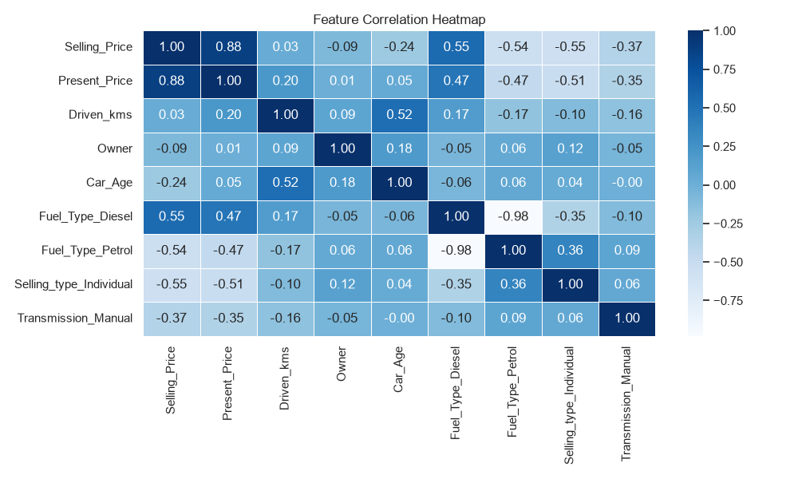
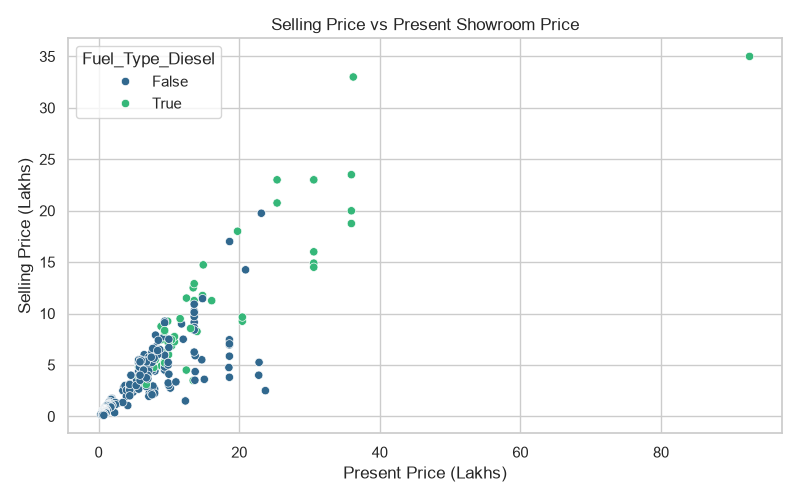
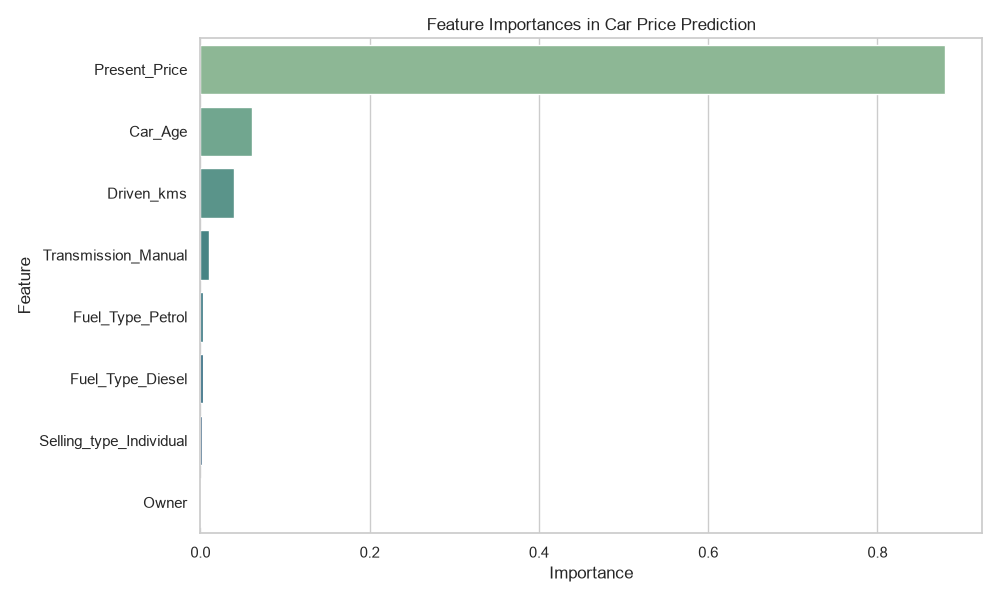

# Car Price Prediction with Machine Learning

**CodeAlpha Data Science Internship — Task 3**

## 📌 Project Overview
This project builds an end-to-end machine learning regression pipeline to predict the resale **Selling Price** of used cars (in Lakhs INR) based on vehicle specifications, showroom price, age, mileage, fuel type, transmission, and ownership history. 

By comparing linear models against ensemble tree-based algorithms, the project identifies the strongest pricing drivers and achieves **$96.2\%$ ($R^2$) prediction accuracy** on unseen test vehicles.

---

## 📂 Dataset Description
The dataset (`car data.csv`) contains **301 vehicles** and **9 columns** with **0 missing values**:

| Column Name | Description | Data Type |
| :--- | :--- | :--- |
| `Car_Name` | Name/model of the vehicle (98 unique models) | Categorical (Text) |
| `Year` | Manufacturing year of the vehicle ($2003\text{–}2018$) | Numerical (Integer) |
| `Selling_Price` | **Target Variable:** Resale price of the vehicle (in Lakhs) | Numerical (Float) |
| `Present_Price` | Current original showroom price of the vehicle (in Lakhs) | Numerical (Float) |
| `Driven_kms` | Total distance driven by the vehicle (in kilometers) | Numerical (Integer) |
| `Fuel_Type` | Fuel category (`Petrol`, `Diesel`, or `CNG`) | Categorical (Text) |
| `Selling_type` | Seller category (`Dealer` or `Individual`) | Categorical (Text) |
| `Transmission` | Gear transmission type (`Manual` or `Automatic`) | Categorical (Text) |
| `Owner` | Number of previous owners ($0$, $1$, or $3$) | Numerical (Integer) |

---

## ⚙️ Data Preprocessing & Feature Engineering
1. **Feature Creation (`Car_Age`):** Calculated the vehicle's age (`Current_Year - Year`) to directly measure depreciation over time, then dropped the raw `Year` column.
2. **Dimensionality Reduction:** Removed `Car_Name` (98 unique text categories) to prevent overfitting on a 301-row dataset.
3. **One-Hot Encoding:** Converted categorical text columns (`Fuel_Type`, `Selling_type`, `Transmission`) into binary numerical indicators ($0$ or $1$) using `pd.get_dummies(drop_first=True)`.
4. **Train-Test Split:** Divided the dataset into **$80\%$ training data (240 cars)** and **$20\%$ testing data (61 cars)** using `random_state=42`.

---

## 📊 Exploratory Data Analysis & Visualizations

### 1. Feature Correlation Heatmap
The heatmap highlights how strongly each feature moves with `Selling_Price`. `Present_Price` shows the strongest positive correlation ($+0.88$), while `Fuel_Type_Diesel` ($+0.55$) correlates positively with higher resale value.



### 2. Selling Price vs. Showroom Price
Vehicles with higher original showroom prices consistently command higher resale prices, with Diesel vehicles clustering toward the upper price tier.



### 3. Feature Importance (What Drives Used Car Prices?)
Our Random Forest model reveals that a car's **Original Showroom Price (`Present_Price`) accounts for $88.1\%$** of the resale price decision, followed by **Car Age ($6.0\%$)** and **Kilometers Driven ($4.0\%$)**.



---

## 🤖 Model Performance Comparison
Four regression algorithms were trained and evaluated on the 61 unseen test vehicles using **Mean Absolute Error (MAE)**, **Root Mean Squared Error (RMSE)**, and **$R^2$ Score**:

| Model | MAE (Lakhs) | RMSE (Lakhs) | $R^2$ Score | Accuracy (%) |
| :--- | :---: | :---: | :---: | :---: |
| **Linear Regression** | $1.21$ | $1.87$ | $0.8489$ | $84.89\%$ |
| **Ridge Regression ($\alpha = 1.0$)** | $1.20$ | $1.86$ | $0.8500$ | $85.00\%$ |
| **Random Forest Regressor** | $0.64$ | $0.97$ | $0.9595$ | $95.95\%$ |
| **Gradient Boosting Regressor** | **$0.62$** | **$0.93$** | **$0.9625$** | **$96.25\%$** |

### Why Tree Models Outperformed Linear Models:
* **Linear & Ridge Regression ($\sim 85\%$ accuracy)** apply fixed straight-line depreciation rules (subtracting the same flat amount per year of age regardless of whether the vehicle is a budget commuter or a luxury SUV).
* **Random Forest & Gradient Boosting ($\sim 96\%$ accuracy)** use decision-tree flowcharts that capture non-linear depreciation proportional to the vehicle's showroom price.

---

## 💡 Key Business Insights
* **Showroom Value Anchors Resale Price:** Over $88\%$ of a used vehicle's price prediction is determined by its original showroom price (`Present_Price`).
* **Age Depreciates Value Faster Than Mileage:** Vehicle age (`Car_Age`) has a stronger negative impact on resale price ($6.0\%$ weight) than total kilometers driven ($4.0\%$ weight).
* **Dealer & Diesel Premiums:** Diesel vehicles (mean: $10.28\text{ Lakhs}$) and dealer-sold listings (mean: $6.72\text{ Lakhs}$) sell for higher prices largely because they have higher initial showroom prices.

---

## 🗂️ Repository Structure
```text
CodeAlpha_Car_Price_Prediction/
│
├── car data.csv                  # Raw dataset (301 rows, 9 columns)
├── car_price_prediction.ipynb    # Jupyter Notebook with EDA, plots, and ML models
├── correlation_heatmap.png       # Generated correlation matrix plot
├── price_vs_showroom.png         # Generated scatter plot
├── feature_importance.png        # Generated feature importance bar chart
├── requirements.txt              # Required Python libraries
└── README.md                     # Project documentation
```

---

## 🚀 How to Run This Project Locally

1. **Clone the repository:**
   ```bash
   git clone https://github.com/YOUR_USERNAME/CodeAlpha_Car_Price_Prediction.git
   cd CodeAlpha_Car_Price_Prediction
   ```

2. **Create and activate a virtual environment (optional):**
   ```bash
   python -m venv venv
   # Windows:
   venv\Scripts\activate
   # Mac/Linux:
   source venv/bin/activate
   ```

3. **Install dependencies:**
   ```bash
   pip install -r requirements.txt
   ```

4. **Launch the Jupyter Notebook:**
   ```bash
   jupyter notebook car_price_prediction.ipynb
   ```